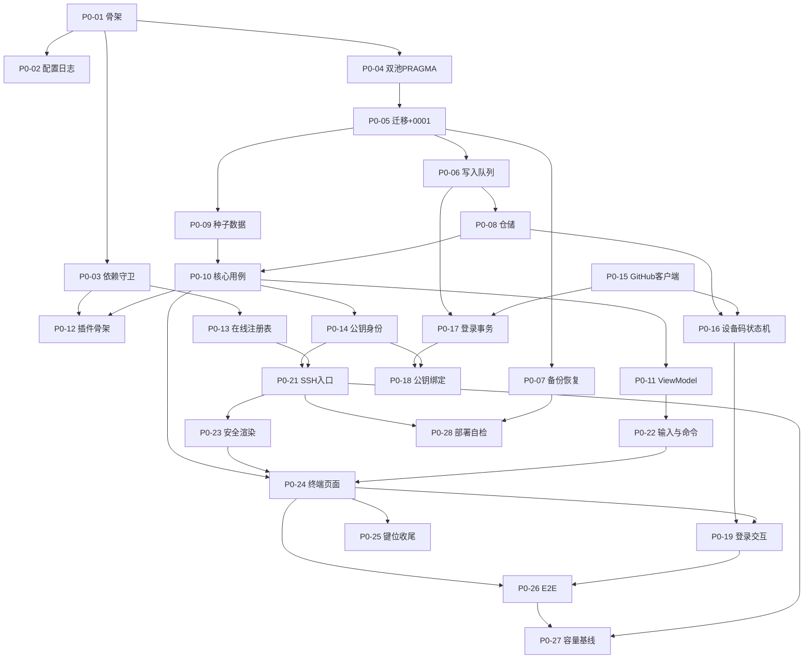

# P0 实施计划（核心论坛闭环）

> 状态：**Q1–Q7 已全部拍板（2026-11-18）**；**M0 与 M1 全部完成**（P0-01 ~ P0-13），下一步 M2 认证
> 依据：设计评审稿 v0.2 §6（P0 范围）、§2.2（模块边界）、§2.3（统一 ViewModel）、§2.4（插件权限）、§2.6（写入边界）、§3.5（安全渲染）、§4.4（Device Flow）
> 托管：`git@github.com:jeeinn/motd.git` ｜ module：`github.com/jeeinn/motd`
> 更新：2026-11-18 12:20

---

## 1. 范围锚点

评审稿 §6 给 P0 的验收是一句话：**新用户连接 → 注册 → 浏览 → 发帖 → 回复，闭环跑通**。这句话在验收时容易各说各话，因此拆成 7 条可判定的 DoD：

| # | 可判定标准 | 判定方式 |
| --- | --- | --- |
| D1 | 陌生机器执行 `ssh -p 2222 <host>` 能进入 TUI，以访客身份浏览版块与主题列表 | 手工 + 集成测试 |
| D2 | 会话内 `/login github` 走完 Device Flow，会话升级为登录态，且当前连接的公钥自动绑定到该账号 | 集成测试（假 GitHub 端点） |
| D3 | 断开重连后不再要求登录，直接具备写权限（公钥指纹命中 `ssh_keys`） | 集成测试 |
| D4 | 能在 `/dev/ai` 发主题、在他人主题下回复；另一个账号可见 | 集成测试（两个会话） |
| D5 | 提交含 `ESC` / `CSI` / `OSC 52` / `\r` 覆盖 / 双向文本的内容，不影响他人终端的光标、标题与剪贴板 | 恶意样本回归集 |
| D6 | 进程重启后帖子、账号、公钥绑定全部还在；`kill -9` 后 WAL 不丢已提交事务 | 重启演练 |
| D7 | 从备份文件恢复到空目录，行数与内容校验一致；恢复步骤有文档且被实际执行过一次 | 恢复演练 |

### 1.1 P0 明确不做（范围守门）

| 项 | 归属 | 说明 |
| --- | --- | --- |
| 邮箱注册 / 验证码 / 账号恢复 / 密码登录 | P1 | 表结构已建，`local_credentials`、`email_tokens` 在 P1 才写入 |
| 浏览器 TUI、Frame 增量协议、WebSocket | P1 | P0 不做任何前端，`/healthz` 之外的 HTTP 端点一律不接 |
| Device Flow 的 HTTP 端点（`/auth/device/start`、`/poll`） | P1 | **Q3 已拍板**：P0 进程内直接调用 application 用例，不引入 Web 会话与 CSRF 面 |
| 点赞 / 搜索 / 声望计算 / 成就系统 | P1 | `votes`、`achievements` 表建好但不写；插件只留接口骨架 |
| FTS5 全文索引 | P1 | 迁移里不含 FTS 表，避免 P0 背同步负担 |
| RSS / 只读 API / AI 摘要 / 原生 CLI token | P2 | — |
| 压测到 1000 连接 | P3 | P0 只做 100 连接基线，用来尽早暴露架构级问题 |
| 多层评论树 | 不做 | `parent_post_id` 预留不启用 |

判断某件事该不该进 P0 只用一条标准：**不做它，D1–D7 是否还能全部满足**。不能，才进 P0。

---

## 2. 里程碑总览

| 里程碑 | 主题 | 任务 | 完成判据 |
| --- | --- | --- | --- |
| **M0** 地基 | 可运行、可迁移、可备份的单进程 | P0-01 ~ P0-07 | `go test ./...` 全绿；空目录启动即建库；备份可恢复 |
| **M1** 领域与用例 | 无 UI 也能发帖的业务内核 | P0-08 ~ P0-13 | 用例层测试覆盖权限与校验，不依赖 SSH 即可跑通 |
| **M2** 认证 | 公钥身份 + Device Flow | P0-14 ~ P0-20 | D2、D3 达成 |
| **M3** 终端 | SSH 入口 + 安全渲染 + 页面 | P0-21 ~ P0-25 | D1、D5 达成 |
| **M4** 闭环 | 端到端与运维 | P0-26 ~ P0-28 | D4、D6、D7 达成 |

已完成：**P0-01 ~ P0-13**，M0 与 M1 全部关死。每项均「测试通过 → 单独提交」。M1 验收「无 UI 也能发帖、用例层测试覆盖权限与校验」已由纯内存 fake 测试 + 真实 SQLite 集成测试 + 端到端装配测试共同满足。

---

## 3. 任务清单

每个任务给出：目标、产出物、验收、依赖、量级（人日，相对量级参考，非承诺）。

### M0 地基

**P0-01 仓库与模块骨架** ✅
- 产出：`go.mod`、`cmd/server`、`internal/{transport,application,domain,infrastructure,presentation,plugin}`、每个包的边界 `doc.go`
- 验收：`go build ./...` 通过；目录与设计 §2.2 一致
- 依赖：无 ｜ 量级：1

**P0-02 配置 / 日志 / 优雅停机 / 探针** ✅
- 产出：`internal/config`、`slog` 初始化、`signal.NotifyContext` 停机、`GET /healthz`
- 验收：非法日志级别拒绝启动；SIGTERM 后 10s 内退出
- 依赖：P0-01 ｜ 量级：0.8

**P0-03 依赖方向守卫（archtest）** ✅
- 目标：把 §2.2 的依赖方向从文档变成会失败的测试，防止三个月后 domain 里悄悄 import 了 sqlite
- 产出：`internal/archtest/deps_test.go`，用 `go/build` 或 `golang.org/x/tools/go/packages` 解析 import 图
- 规则：`domain` 不得 import `transport|presentation|infrastructure|plugin`；`transport` 不得 import `infrastructure`；`presentation` 不得 import `transport|infrastructure`；`plugin` 不得 import `infrastructure`
- 验收：手工加一条 `domain → infrastructure` 的 import，测试必须失败；恢复后必须通过
- 依赖：P0-01 ｜ 量级：0.5

**P0-04 SQLite 双池 + PRAGMA 基线** ✅
- 产出：`internal/infrastructure/sqlite/db.go`（写池 MaxOpenConns=1 + `_txlock=immediate`，读池 `NumCPU`，PRAGMA 走 DSN 逐连接生效）
- 验收：启动自检 `foreign_keys=1`、`journal_mode=wal`，不符即拒绝启动
- 依赖：P0-01 ｜ 量级：0.8

**P0-05 版本化迁移 + 0001 schema** ✅
- 产出：`migrate.go`（embed + 单事务 + 版本登记）、`migrations/0001_init.sql`（14 张表）、6 条回归测试
- 验收：重复执行不重复应用；迁移失败整体回滚；库版本高于二进制时拒绝启动
- 依赖：P0-04 ｜ 量级：1

**P0-06 写入队列与事务边界** ✅
- 目标：把 §2.6 的规则做成代码，而不是散文
- 产出：`infrastructure/sqlite/write.go` —— `chan WriteTask`（容量 256）、`WithWriteTx(ctx, fn)` 封装、错误分类（`ErrQueueFull` / `ErrBusy` / `ErrTimeout`）、`SQLITE_BUSY` 有限次退避重试
- 规则：队列满**快速失败**不阻塞；每次写入带 `context` 超时（默认 3s）；一个业务用例一个事务；事务提交后才向用户回执成功
- 验收：200 个并发写不出现无限堆积；人为压满队列后立即返回 `ErrQueueFull`；BUSY 重试上限明确且不吞错
- 依赖：P0-04 ｜ 量级：1.5
- 风险：事务封装一旦被绕过，后面所有用例的正确性都不可靠。做法：`sqlite` 包不导出裸 `*sql.DB` 给 application，只导出 `WriteTx`/`ReadQuery` 门面

**P0-07 备份与恢复** ✅
- 目标：满足 D7，同时把 §7「备份的成功标准是能恢复」落成脚本
- 产出：`scripts/backup.sh`（`VACUUM INTO` + sha256 + 时间戳命名）、`scripts/restore.sh`、`docs/OPS.md`（周期、保留、异地、RTO/RPO 初值）
- 验收：备份→删库→恢复→`PRAGMA integrity_check` 通过 + 关键表行数一致；演练记录写进 `docs/OPS.md`
- 依赖：P0-05 ｜ 量级：1
- 备注：`VACUUM INTO` 只做 P0 手段；SQLite Online Backup API 的引入条件（库大于某个尺寸、或备份期间锁等待超阈值）写进 OPS 文档待评估

### M1 领域与用例

**P0-08 仓储接口与 SQLite 实现** ✅
- 产出：`application/forum` 侧的端口接口（`NodeReader` / `ThreadReader` / `PostReader` / `UnitOfWork` + `WriteTx`）+ `infrastructure/sqlite` 实现；新增 `domain/node`
- 约束：接口定义在使用方（application），实现在 infrastructure；不返回 `*sql.Rows`，只返回领域结构
- 验收：仓储测试覆盖分页、排序（最新 / 最高分）、软删除过滤
- 依赖：P0-06 ｜ 量级：2
- 执行补充：`Repos` 聚合三个端口时 Go 不允许同名不同签名的方法，故统一命名为 `ListNodes` / `ListThreads` / `ListPosts` / `GetThread`；`infrastructure → application` 是合法方向（禁止表只拦反向）；新增 archtest 守卫禁止 application 出现 `database/sql` / `modernc.org/sqlite` import，实测注入后退出码 1。分页用 keyset（排序键 + id）而非 OFFSET。

**P0-09 版块种子数据** ✅
- 产出：`migrations/0002_seed_nodes.sql`（`/dev/ai`、`/dev/rust`、`/dev/jobs`、`/etc/rant`、`/bin/help`）
- 验收：空库迁移后 `nodes` 有 5 行；重复迁移不重复插入
- 依赖：P0-05 ｜ 量级：0.3
- 执行补充：`INSERT OR IGNORE` 保证手工重放也不覆盖已有名称。**连带修复一个真实回归**：M0 的写入队列/备份测试把 `nodes` 当空表并硬编码绝对行数，种子落地后 7 条测试全挂；已改为「迁移后 baseline + 相对增量」断言，今后增删版块不再破坏测试。

**P0-10 论坛核心用例** ✅
- 产出：`ListNodes` / `ListThreads(nodeID, sort, cursor)` / `GetThread` / `CreateThread` / `CreatePost`
- 规则：标题 1–120 字符且非空白；正文非空、上限 8 KiB（防止一条内容打满带宽）；仅 `users.status=active` 可写；访客只读；`last_reply_at` 与 `threads.score` 在同一事务内更新；发帖限流**每人 60 秒 1 帖、每小时 10 帖**，命中时返回剩余冷却时间（Q6 已拍板）
- 验收：用例测试覆盖上述每条规则；创建 Post 后 `last_reply_at` 必须变化
- 依赖：P0-08 ｜ 量级：3
- 执行补充：
  1. `Actor` 由 M2 的 `Principal` 映射，P0-10 不依赖认证实现；权限在事务内**再查一次** DB 状态，避免会话快照过期。
  2. `CreateThread` 同事务写入主题 + 首帖（§5.2 定义 Post 含首帖）；限流按 `COUNT(DISTINCT created_at)` 去重，否则一次发帖会消耗两份配额。
  3. `TouchThread` 用一条 UPDATE 同时维护 `last_reply_at` 与 `score`；P0 无投票来源故 `scoreDelta=0`，P1 投票可直接复用这条事务路径（不臆造 P0 计分语义）。
  4. 新增 `0003_rate_limit_indexes.sql`：`(user_id, created_at)` 覆盖索引，执行计划实测 `SEARCH ... USING COVERING INDEX`，避免每次写入全表扫描。
  5. 时间存 Unix 秒，**同一秒内的回复不会推进 `last_reply_at`**；排序有 `id` 作 tie-breaker，不影响正确性，测试用可控时钟跨秒验证。

**P0-11 ViewModel 定义** ✅
- 目标：把 §2.3 的「共享应用状态、不共享渲染结果」落到具体结构
- 产出：`application/viewmodel`（`Screen` / `Row` / `StatusBar` / `Overlay` + 全部枚举）、`application/forum/viewmodel.go`（领域结果 → 语义状态映射）、`domain/user/level.go`（Q5 等级分档）
- 约束：只含语义字段，不含颜色、宽度、ANSI；`Kind` 用枚举而非字符串魔法值
- 验收：ViewModel 里出现任何样式/终端概念即为不合格（评审项）
- 依赖：P0-10 ｜ 量级：1
- 执行补充：
  1. **路径偏离计划**：类型独立成 `application/viewmodel`，`application/forum/viewmodel.go` 只做映射。登录屏 / 帮助屏不属于论坛用例，类型放 `forum` 会让 M2 的 auth、M3 的页面反向 import forum（语义倒置）。application 组内互引合法，不破坏 §2.2。详见 ADR-014。
  2. 按 §2.3 的图补 `Selection` / `Pagination` / `Detail`，`Row` 补 `Body`：详情屏既要主题正文又要回复列表，计划里 4 + 5 个字段无法表达。
  3. 三重守卫：archtest AST 静态扫描（渲染库 import / 渲染标识符 / 控制序列）、反射类型断言（禁函数 / 指针 / 接口 / 通道 / `time.Time`）、真实注入实测退出码 1。禁用词按**驼峰词段精确匹配**，避免 `EmptyRows` 命中 `pty`、`Description` 命中 `esc`；`NextCursor` 是分页游标不拦。
  4. `RowMeta.AuthorID` 暂留语义 ID，仓储未 join `users`；P0-23 页面展示作者名时补投影（已记为 R11）。

**P0-12 领域事件与插件骨架** ✅
- 产出：`domain/event`（事件结构）、`plugin/events`（领域事件 vs 交互事件两条通道，不共用总线）、`plugin/registry`（`init()` 注册）、`plugin/demo`（订阅 `PostCreated` 并申请成就）、`application/user`（成就校验门）、`cmd/server/wiring.go`（装配层）
- 约束：插件只能拿到只读查询接口与「申请解锁成就」这一条写路径；成就仍由 `application/user` 校验后写入
- 验收：archtest 证明插件包无法 import `infrastructure/sqlite`；demo 插件在发帖后触发且可观测
- 依赖：P0-10、P0-03 ｜ 量级：1.5
- 执行补充：
  1. **依赖方向**：`application` 不能 import `plugin`，故 `forum.DomainEventSink` 用 `domain/event` 类型声明，`events.DomainBus.Publish` 结构化匹配实现；`plugin` 不能 import `infrastructure`，受限 `registry.Context` 由 cmd 装配注入。archtest 两条守卫实测注入后退出码 1（ADR-015）。
  2. **发布时机**：`repos.Write` 成功返回后（事务已提交）才发 `EventPostCreated`；投递失败不回滚、不改变用例返回值，只计数 + observer 上报，避免误判失败重试出重复帖。
  3. **P0 不写库**：成就是内存占位（`MemoryAchievementStore`），`achievements` 表已建但不写；P1 换持久化实现即可，校验逻辑不变。范围守门「成就系统属 P1」保持。
  4. 端到端测试用真实 SQLite + 真实队列 + 真实插件链验证：发帖 → 事件 → demo → 成就解锁且只解锁一次；从零启动实测 `plugins=1 post_created_subscribers=1`。

**P0-13 内存连接注册表** ✅
- 产出：`application/presence` —— 在线连接数、每会话状态、心跳超时（20s）、活跃独立统计、峰值与快照
- 约束：**不写 SQLite**（§2.6 明确：为维护在线状态耗尽唯一写通道是本末倒置）
- 验收：100 个模拟连接上下线，写库次数为 0
- 依赖：P0-03 ｜ 量级：0.5
- 执行补充：
  1. 两层证明零写库：archtest 静态禁 `database/sql` / `modernc.org/sqlite` / `infrastructure` import（实测注入退出码 1）；运行时给 `Writer` 加 `Commits()` 计数器，先做一次真实写入得基线 1，再跑 100 连接上下线 + 心跳 + `Reap`，断言**增量严格为 0**。计数器自身有回归（失败 / 唯一冲突不计数），防「恒为 0」假绿。
  2. `Active` 只认心跳窗口内且 Browsing / Composing 的会话，与 `Online` 独立统计（§2.7）；认证中、Idle 不计入。
  3. 已装配进 `cmd/server`：每 10s `Reap`（随 ctx 取消退出），`/healthz` 输出 `online/active/commits`；ADR-006「纯运维探针」语义不变。M3 SSH 入口才真正登记连接，当前为空表。

### M2 认证

**P0-14 身份解析：公钥 → 用户**
- 产出：`application/auth` 的 `Principal`（`Kind: guest|user`、`UserID`、`KeyFingerprint`）与解析函数
- 规则：指纹命中未吊销的 `ssh_keys` → 登录态；未命中 → 访客只读；命中已吊销 → 拒绝认证（§4.6 三状态）
- 验收：三种状态各有测试；访客调用写用例返回明确的权限错误而非 panic
- 依赖：P0-10 ｜ 量级：0.5

**P0-15 GitHub Device Flow 客户端**
- 产出：`infrastructure/github/device.go` —— `POST /login/device/code`、`POST /login/oauth/access_token`、`GET /user`、`GET /user/emails`
- 规则（已对照官方文档复核，见 §7）：
  - 换 token **不需要** `client_secret`，`grant_type=urn:ietf:params:oauth:grant-type:device_code`
  - `authorization_pending` → 继续；`slow_down` → **在当前 interval 上加 5 秒**（用响应返回的新值）；`expired_token` → 重新申请；`access_denied` → 终止
  - **设计稿未列**的 `device_flow_disabled`、`incorrect_client_credentials`、`incorrect_device_code` 必须显式处理并映射为可读错误
  - `scope` 最小集 `read:user user:email`；响应按 JSON 解析（`Accept: application/json`）
- 验收：用 `httptest` 假端点覆盖全部错误分支；轮询间隔不得小于 `interval`
- 依赖：P0-03 ｜ 量级：1.5
- 前置（Q7 已拍板）：**第二波（M1 结束）前**注册 GitHub OAuth App 并启用 Device Flow，`client_id` 只放服务端环境变量；本任务开发期一律用 `httptest` 假端点，不等真实凭据
- Q3 约束：P0 由 SSH 会话在**进程内**调用本客户端，不开 HTTP 端点；`infrastructure/github` 只暴露 Go 接口，不绑定 transport

**P0-16 Device Flow 状态机**
- 产出：`device_auth_states` 的读写与状态迁移用例（`pending → authorized|denied|expired`）
- 规则：状态跨请求存活因此必须持久化，不复用 `oauth_states`；`session_ref` 关联发起登录的 SSH 会话；同会话重复发起以最后一次为准并作废旧码
- 验收：状态迁移非法路径被拒绝；过期码不再轮询
- 依赖：P0-08、P0-15 ｜ 量级：1

**P0-17 账号创建与登录事务**
- 产出：`application/auth.Login` —— 按 §4.3 顺序判定：`(provider, provider_uid)` 命中即登录；邮箱命中但身份未命中**不自动合并**，提示先登录原账号再 `/link`；都不命中则原子创建 `users` + `identities`
- 规则：`provider_uid` 取 GitHub 数字 `id`；只接受 primary 且 `email_verified` 的邮箱；用户名冲突由 `NOCASE UNIQUE` 兜底并追加数字后缀重试
- 用户名必须先过 `domain/user.ValidateUsername`（Q1–Q7 后规则：中文 / 英文字母 / 数字 / `_` / `-`，3–20 字符，无空白；事实来源见 ADR-005），不能只依赖 DDL
- 验收：并发同 UID 首登只产生一个用户（唯一约束 + 重试）；邮箱相同但 UID 不同必须建成两个账号
- 依赖：P0-15、P0-06 ｜ 量级：1.5

**P0-18 公钥绑定**
- 产出：`/keys`、`/key add`、`/key rm <fingerprint>` 与绑定用例
- 核心约束（§4.6）：绑定的是**认证阶段服务端已持有的 `ssh.PublicKey` 的指纹**，不接受客户端提交的公钥文本；未持有私钥证明的连接不得绑定
- 规则：一钥只属一号；解绑只影响该钥；解绑后撤销相关会话；访客会话升级失败时保留访客态不落半成品
- 验收：伪造提交"别人的公钥字符串"无法完成绑定
- 依赖：P0-14、P0-17 ｜ 量级：1

**P0-19 登录交互与会话升级**
- 产出：终端内的 Device Flow 呈现（`user_code` + `verification_uri` + 剩余时间 + 取消键）、轮询期间的界面状态、成功后会话从 `guest` 升级为 `user`
- 约束：轮询在服务端进行，终端只展示状态，不持有任何 token；**Q3 已拍板**：整条链路是进程内 `SSH session → application/auth → infrastructure/github`，不经过 HTTP，因此 P0 无 Web 会话与 CSRF 面
- 验收：D2 手工跑通；中途 `Esc` 取消后 `device_auth_states` 进入 `denied` 且不留下未绑定半成品
- 依赖：P0-16、P0-23、P0-24 ｜ 量级：1

**P0-20 安全日志与基础限流**
- 产出：`auth_events` 写入（登录失败、验证码/设备码错误、state 不匹配）、Device Flow 发起频率限制、绑定尝试次数限制
- 规则：`ip_hash` 而非明文 IP；限流计数走内存（同 P0-13 理由）
- 验收：连续超限返回可读提示且不写库刷量
- 依赖：P0-17 ｜ 量级：1

### M3 终端

**P0-21 SSH 服务入口**
- 产出：`transport/ssh` —— `gliderlabs/ssh` Server（**默认监听 `2222`**，Q4 已拍板）、host key（ed25519，首次生成落 `data/`，权限 0600）、`PublicKeyHandler`、PTY、`WindowSize` 处理、空闲超时、最大连接数
- 规则：仅公钥认证，禁密码、禁 root；超限拒绝新连接（§1.2 容量口径）；单连接一个 goroutine 树，退出必须回收
- 验收：`ssh -p 2222 localhost` 能进；错误 key 被拒；连接数打满时新连接收到明确拒绝
- 依赖：P0-13、P0-14 ｜ 量级：2

**P0-22 输入归一化与命令注册表**
- 产出：SSH 字节流 → `KeyMsg`（`j/k/h/l`、`Enter`、`Esc`、`Ctrl-*`、可打印字符、粘贴）；`/` 斜杠命令表（`/top`、`/open`、`/new`、`/reply`、`/login`、`/keys`、`/help`、`/quit`）
- 约束：命令表是**唯一**入口，鼠标/快捷键在 P1 也映射到命令，不产生第二条业务路径（§3.2）
- 验收：`?` 显示全部命令且与实际注册表一致（由注册表生成，不手写两份）
- 依赖：P0-11 ｜ 量级：1

**P0-23 终端安全渲染（P0 重点，不可压缩）**
- 目标：把 §3.5 从「过滤」升级为「分层安全渲染」
- 产出：`presentation/terminal/safe` —— 纯文本净化 → 白名单 Markdown 解析 → 受控 ANSI 生成，三段分离
- 规则：
  - 用户输入中的 `ESC` / `CSI` / `OSC`（含 OSC 52 剪贴板、窗口标题）一律按可见字符转义或剥离，不透传
  - 链接协议白名单（`http` / `https` / `ssh`），拒绝 `file:`、`javascript:`、`data:`
  - 用户内容不得写光标位置、不得清屏、不得改变窗口标题
  - **服务端生成的 ANSI 与用户提交的 ANSI 走不同函数**，不共用同一个 sanitize
  - `\r` 覆盖、超长单行（折行而非截断）、制表符、双向文本（RTL override）都要有明确处理
- 验收：恶意样本集（≥ 12 条）全部不产生终端异常；样本集作为测试固化，不允许只靠人工看
- 依赖：P0-21 ｜ 量级：2.5
- 风险：这是 P0 唯一的「做浅了等于没做」的模块。宁可页面少一个，也不要渲染器降级

**P0-24 终端页面**
- 产出：版块列表 / 主题列表 / 主题详情 / 发帖编辑器 / 回复编辑器 / 登录引导 / 帮助浮层
- 规则：列表行 `序号 + 赞数 + 标题 + 元信息`；状态栏 `online / karma / 等级`；分页加载；编辑态支持多行与取消；**等级按 Q5 已拍板口径**：karma 分档常量 `0 / 10 / 50 / 200 → L1–L4`，放在 `domain/user`，P0 不做动态计分
- 验收：D1 手工跑通全流程；窄终端（40 列）不破版；宽字符（中文、emoji）对齐正确
- 依赖：P0-22、P0-23、P0-10 ｜ 量级：3

**P0-25 状态栏与键位收尾**
- 产出：`View()` 组装、`?` 帮助、`q` 返回层级、`r` 回复、`/` 搜索占位（P0 只做标题前缀匹配或明确提示"P1 提供"）
- 验收：任意页面都能回退到版块列表且不丢滚动位置
- 依赖：P0-24 ｜ 量级：1

### M4 闭环与运维

**P0-26 端到端冒烟**
- 产出：`test/e2e` —— 用真实 SSH 客户端（`golang.org/x/crypto/ssh`）连本地服务，脚本化按键序列，断言 D1–D4
- 约束：GitHub 用 `httptest` 假端点，测试不依赖外网与真实凭据
- 验收：`go test ./test/e2e -tags=e2e` 一条命令跑完整个闭环
- 依赖：P0-19、P0-24 ｜ 量级：1.5

**P0-27 容量基线（100 连接）**
- 产出：`scripts/load.sh` + 结果记录到 `docs/OPS.md`
- 目标：不是达标 1000，而是尽早暴露「每连接内存」「goroutine 泄漏」「写队列排队」三类结构性问题
- 验收：100 并发连接下 RSS、写队列深度、p99 首屏时间有数；连接全部断开后 goroutine 回到基线
- 依赖：P0-21、P0-26 ｜ 量级：0.5

**P0-28 部署与自检**
- 产出：`deploy/motd.service`（systemd，`GOMEMLIMIT=800MiB`、`GOGC=50`、`Restart=on-failure`）、启动自检（数据目录权限、迁移版本、host key 存在）、备份 cron 示例、对外 22 → 本机 `2222` 的转发配置（Q4）
- 验收：一台干净机器按 `docs/OPS.md` 从零部署到可用；重启后自动恢复服务
- 依赖：P0-07、P0-21 ｜ 量级：1

**量级合计：约 31 人日**（含已完成的 4 项约 3.6 人日）。

---

## 4. 依赖图

---

## 5. 关键路径与并行策略

**关键路径（决定 P0 总工期）**：
`P0-01 → 04 → 05 → 06 → 08 → 10 → 11 → 21 → 23 → 24 → 19 → 26`

链上最长的三块是 **P0-10 核心用例（3）**、**P0-23 安全渲染（2.5）**、**P0-24 终端页面（3）**。想把总工期压下来，只有两个方向：把 P0-23 的样本集提前写好（写测试比改渲染器便宜），或把 P0-24 的页面数砍到 4 个（砍帮助浮层与搜索占位）。

**可并行支线**：
- M2 的 `P0-15 → 16 → 17`（纯认证逻辑 + 假端点测试）与 M1 的 `P0-08 → 10`（纯数据与用例）互不阻塞，可交替推进 —— 两条线的接口在 `Principal` 与仓储上汇聚。
- `P0-07 备份恢复`、`P0-12 插件骨架`、`P0-13 在线注册表` 是三条独立小支线，适合在等编译或等 review 的空档做。

**建议波次**：
1. 第一波（已部分完成）：M0 全部 → 得到可启动、可迁移、可备份的地基
2. 第二波：M1 全部 → 无 UI 也能发帖，用 `go test` 就能验证业务规则
3. 第三波：M3 的 21 → 23（先有 SSH 入口和安全渲染，再有页面，避免页面写完发现渲染边界是错的）
4. 第四波：M2 全部 → 接上认证，D2/D3 达成
5. 第五波：24 → 25 → 26 → 27 → 28

> 第三波与第四波的顺序可互换。先做 SSH + 安全渲染的好处是能最早用真实终端验证渲染边界；先把认证做完的好处是可以边写页面边登录调试。若只有一个人做，建议按上面顺序。

---

## 6. 已拍板结论（Q1–Q7）

> **2026-11-18：V 先生明确答复「Q1–Q7 七项待拍板，我全部同意」。** 本节不再是待决策清单，以下为执行口径；完整决策记录见 `DECISIONS.md ADR-009`。

| # | 已生效结论 | 已落到哪里 |
| --- | --- | --- |
| Q1 | §8.2 四项架构决策**全部采纳**：模块化单体与 Domain 解耦、统一 ViewModel + 双 Renderer、所有持久化写入必经 Application 且插件禁直连数据库、在线状态与业务数据分离且心跳不逐次持久化 | ADR-001/002/003；P0-03 依赖守卫、P0-11 ViewModel、P0-12 插件骨架、P0-13 内存注册表 |
| Q2 | 托管仓库 `git@github.com:jeeinn/motd.git`；module path `github.com/jeeinn/motd` | ADR-008；`go.mod` 与全部 import 已全量替换 |
| Q3 | P0 的 Device Flow **进程内直接调用 application 用例**；HTTP 端点（`/auth/device/start`、`/auth/device/poll`）留到 P1 浏览器接入时再开 | §1.1 不做清单、P0-15/16/19；P0 不引入 Web 会话与 CSRF 面 |
| Q4 | SSH 默认监听 **`2222`**，避免 root / `CAP_NET_BIND_SERVICE`；对外 22 端口由 `iptables` 或 `setcap` 转发 | P0-21、P0-28、D1 验收命令 |
| Q5 | 状态栏「等级」按 karma 分档常量 **`0 / 10 / 50 / 200 → L1–L4`**，放在 `domain/user` | P0-24 / P0-25 |
| Q6 | 发帖限流 **每人 60 秒 1 帖、每小时 10 帖**，命中时返回剩余冷却时间 | P0-10、P0-20 |
| Q7 | GitHub OAuth App 在**第二波（M1 结束）前**注册并启用 Device Flow；`client_id` 只放服务端环境变量 | P0-15 前置；联调用 `httptest` 假端点，不依赖真实凭据 |

Q1 与 Q3 是结构性决策。若后续要改，M0 的依赖守卫与 M2 的认证链路都要重做，改动前应先出 diff 评审。

---

## 7. 复核发现（对设计稿的偏差与补漏）

设计稿 `docs/design/…v0.2.md` 是**评审稿快照，不回改**；本节记录实际执行时的偏差，以 `DECISIONS.md` 为最终口径。

| # | 项 | 设计稿 | 复核 / 决策结果 | 处理 |
| --- | --- | --- | --- | --- |
| R1 | Device Flow 是否需要 client_secret | 不需要 | 确认不需要，仅 `client_id` + `grant_type` | 保持 |
| R2 | `slow_down` 的退避语义 | 「增加间隔」 | 官方明确：**在上次 interval 基础上加 5 秒**，且响应返回新 `interval` | 收紧为「取响应新值」，写进 P0-15 |
| R3 | Device Flow 错误码清单 | 只列 4 个 | 缺 `device_flow_disabled`、`incorrect_client_credentials`、`incorrect_device_code` | 补进 P0-15 验收 |
| R4 | GitHub 是否支持 PKCE | 「开发前须独立复核」 | 支持，**仅 `S256`，不支持 `plain`**；`code_challenge` 与 `code_challenge_method` 互为必填 | 已复核，P1 的 Web 流程据此实现 |
| R5 | `users.username` 规则 | `[a-z0-9_-]`，DDL 用 `GLOB '[a-z0-9_-]*'` | ① 原 GLOB 只约束**首字符**，`A_B` / `has space` / `x!y` 都能通过，等于没校验；② V 先生 11-18 决策：放宽为**中文 / 英文字母 / 数字 / `_` / `-`，3–20 字符，不允许任何空白** | 废弃原 GLOB；改为「domain 层正则作唯一事实来源 + DDL 只兜底长度与空白」，详见 ADR-005。已落成 `0001_init.sql`、`domain/user`、两层一致性测试 |
| R6 | 设计稿 §4.5 / §5.1 的用户名口径 | 只允许 ASCII | 已被 R5 决策覆盖 | 归档稿保留原文不改，实际规则以 ADR-005 为准 |
| R7 | `users.primary_email` | 无唯一约束 | 与「禁止按邮箱自动合并」一致，属有意设计 | 保留；但 P1 的 `/link email` 必须显式定义「同一邮箱已被占用」时的处理 |
| R8 | `posts.parent_post_id` | 外键指向 `posts(id)` | 未约束「父子同 thread」 | 当前不启用，启用前必须补约束（记录为 P1 前置） |
| R9 | `threads` 的软删除 | 设计稿 §5.2 未给 `threads` 建 `status` 列 | 现有 schema 只有 `posts.status` 支持软删除 | P0 不做主题删除；P1 启用前必须补字段 + 迁移，否则「删除主题」无处落地 |
| R10 | 发帖限流的计数单位 | 设计稿未定义 | `CreateThread` 同事务产生主题 + 首帖两行；若按行计数，一次发帖消耗两份配额 | 按**发帖动作**计数，用 `COUNT(DISTINCT created_at)` 去重（60 秒冷却保证同用户不会同秒产生两次独立发帖）。用例层与真实 SQL 均有回归测试 |
| R11 | ViewModel 字段集 | 计划只列 `Screen{Kind, Rows, StatusBar, Overlay}`、`Row{Index, Score, Title, Meta, ID}` | §2.3 的状态图还含焦点 / 选中项，详情屏另需主题正文；原字段集无法表达 | 补 `Selection` / `Pagination` / `Detail` / `Row.Body`，并独立成包（ADR-014）。`RowMeta.Author` 暂空：仓储未 join `users`，P0-23 补投影 |
| R12 | 领域事件「可靠投递」的实现边界 | §2.4 要求领域事件可靠投递、可持久化 | P0 只做单进程内同步派发；进程崩溃会丢未处理事件，且无 outbox 表 | P0 范围内可靠（同步、失败可观测）；**P1 前置**：补 `domain_event_outbox` 表，与业务写入同事务落库后再投递（ADR-015） |

R5 是唯一同时改动了 DDL 用户名约束的条目；R10 是本轮发现并修正的语义偏差，R11 是字段集按设计稿补全，R12 是需要带到 P1 的边界。其余为计划内调整。

---

## 8. 下一步

1. Q1–Q7 已拍板；`git push -u origin main` 与 M0 三项提交均已推送，远端 `main` 已建立跟踪。
2. **M0 已全部完成**（P0-01 ~ P0-07），每项均「测试通过 → 单独提交」；备份恢复已完成首次实际演练，记录见 `docs/OPS.md §5`。
3. **第二波 M1 前半段已推送**：P0-08 仓储接口（`172333e`）→ P0-09 种子数据（`00abe57`）→ P0-10 核心用例（`4a9238b`）。三项各自独立提交、全量测试通过，并从零启动实测 `migrations_applied=[1 2 3]`、`nodes=5`、探针正常；2026-11-18 12:00 已 `git push origin main`，远端 `main` = `4a9238b`。
4. **P0-11 ViewModel 已完成**（ADR-014）：状态模型独立成包、Q5 等级分档、领域结果映射、三层守卫实测注入失败。
5. **P0-12 领域事件与插件骨架已完成**（本轮提交，ADR-015）：两条通道分离、成就校验门、编译期注册表、装配层端到端集成测试、插件禁 DB 守卫实测注入失败；从零启动实测 `plugins=1 post_created_subscribers=1`。
6. **P0-13 内存连接注册表已完成**（本轮提交，ADR-016）：静态守卫 + 真实写库计数双重验收，100 连接上下线写库增量为 0；从零启动实测 `/healthz` 输出 `online/active/commits`。**M0 与 M1 全部关死**。
7. 下一步进入 **第三波 M2 认证**（P0-14 ~ P0-20）：`Principal` 身份解析 → GitHub Device Flow 客户端（`httptest` 假端点）→ 状态机 → 公钥绑定 → 会话升级 → 认证限流，目标达成 D2、D3。
8. P0 结束前需补做一次**带真实数据的恢复演练**（当前演练用的是空库），才能把 D7 正式结案。
9. **Q7 已到时点**：GitHub OAuth App 按拍板需在 M1 结束前注册并启用 Device Flow，`client_id` 只放服务端环境变量。M2 开发期一律用 `httptest` 假端点，不依赖真实凭据；若暂不注册，M2 仍可推进但无法做真实联调。
