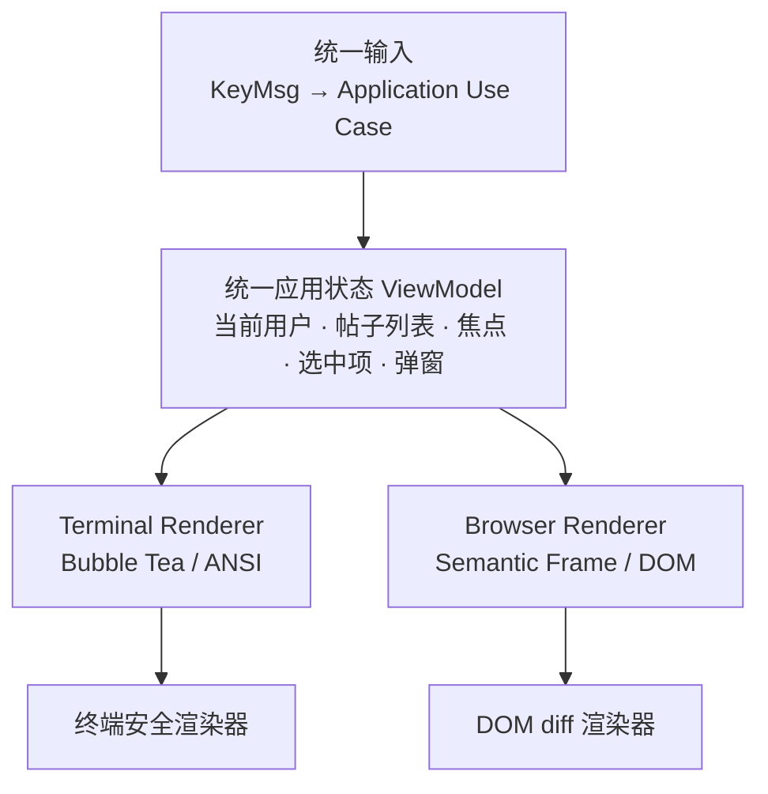
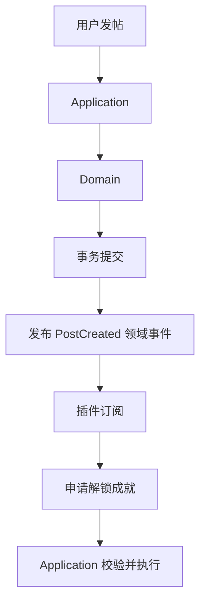

# 命令行论坛整体设计方案-评审稿v0.2

# 命令行论坛整体设计方案（评审稿 v0.2）

> 状态：待评审
> 日期：2026-11-18
> 基于：v0.1 + V先生评审意见
> 评审人：V先生
>
> **修订原则**：让未来增加功能时不必推翻今天的设计，而不是让今天的设计提前容纳所有未来的功能。
>
> **本版变更**：P0 修订 10 项、P1 修订 6 项；保留 Go 单体 + SQLite + SSH TUI 主路线；认证仍为 GitHub + SSH 公钥 + 邮箱，**无 Google 登录**。

---

## 0. 评审导航与修订摘要

### 0.1 章节导航

| 章节 | 内容 | 相对 v0.1 |
| --- | --- | --- |
| 1 | 产品定位、容量口径、三条设计原则 | 修订容量估算，补充双产品属性 |
| 2 | 总体架构、模块化单体、写入边界 | 重大修订：模块边界、ViewModel、插件权限 |
| 3 | 交互设计（终端 + 浏览器 TUI）、安全渲染 | 重大修订：统一状态模型、Frame ops、安全渲染 |
| 4 | 注册与认证 | 重大修订：密码表、PKCE、Device Flow、SSH 绑定 |
| 5 | 统一数据模型、事实来源 | 补充约束、迁移、FTS5 同步 |
| 6 | 实施路线图 | 收缩 P0，重排四阶段 |
| 7 | 风险与红线 | 补充灰度与验收口径 |
| 8 | 待决策点 | 原 6 项 + 新增 4 项架构决策 |
| 附录 A | v0.1 → v0.2 变更对照 | 16 项逐条落地 |

### 0.2 处理结论总表

| # | 事项 | 处理 | 优先级 | 落地章节 |
| --- | --- | --- | --- | --- |
| 1 | Go + SQLite 单体架构 | 保留 | 保留 | 2.1 |
| 2 | 模块化单体边界 | 补充 | P0 | 2.2 |
| 3 | Bubble Tea View 与语义 Frame | 重新定义 | P0 | 2.3、3.1 |
| 4 | 插件数据库访问权限 | 限制 | P0 | 2.4 |
| 5 | 邮箱密码存储缺失 | 修复 DDL | P0 | 4.5、5.1 |

> 章节编号约定：2.2 模块化单体、2.3 统一 ViewModel、2.4 插件权限、2.5 技术栈、2.6 写入队列边界；评审意见中「第 2、3、4、5 章」分别对应本文第 2、3、4、5 节。
> | 6 | PKCE verifier 仅存 Hash | 修复 | P0 | 4.4.2 |
> | 7 | Device Flow 状态管理 | 补充 | P0 | 4.4.1、5.1 |
> | 8 | SSH 公钥绑定机制 | 明确安全边界 | P0 | 4.6 |
> | 9 | Thread/Post/Comment 定义 | 统一领域术语 | P0 | 5.2 |
> | 10 | SQLite 写入队列 | 增加容量和背压 | P0 | 2.6 |
> | 11 | 在线人数与流量估算 | 重新核算 | P1 | 1.2 |
> | 12 | Frame 增量协议 | 补充操作语义 | P1 | 3.3 |
> | 13 | 终端安全渲染 | 加强 | P0 | 3.5 |
> | 14 | 数据库约束与迁移 | 补充 | P1 | 5.3、5.4 |
> | 15 | 备份恢复 | 增加恢复验收 | P1 | 7 |
> | 16 | MVP 实施范围 | 适度收缩 | P1 | 6 |

---

## 1. 产品定位与硬约束

### 1.1 双产品属性

「命令行论坛」实际具有两种产品属性，架构需同时允许，但分阶段实现：

| 属性 | 描述 | 阶段 |
| --- | --- | --- |
| A. SSH 论坛 | 用户连接服务器，像使用远程终端一样浏览讨论 | P0 实现 |
| B. Agent 可参与的社区 | 脚本、自动化程序、AI Agent 通过 CLI/API 参与讨论 | **不在 v0.2 实现身份体系**，只预留约束 |

为属性 B 预留的约束只有四条，不新增组件：

1. 命令有稳定的输入输出契约。
2. 提供 JSON 输出模式（如 `/top --json`）。
3. 身份与权限不依赖具体 UI。
4. Application 层可被不同入口复用。

### 1.2 硬约束与容量口径（修订）

| 约束 | 数值 | 设计含义 |
| --- | --- | --- |
| 单机资源 | 1 核 / 1 GB / 1 Mbps | 单进程、无 Redis / MQ / K8s；静态资源强缓存 |
| 在线规模 | 目标 1000 个在线连接 | **目标容量，非已验证能力**；通过压测逐步验证 100 / 300 / 500 / 1000 |
| 同时活跃 | 独立指标，初期按 100–200 估算 | 不作为 P0 验收标准 |
| 首屏体积 | HTML ≤ 8 KB、JS ≤ 15 KB gzip、CSS ≤ 2 KB | 浏览器 TUI 自研渲染器，不用 xterm.js |
| 部署形态 | 单个 Go 静态二进制 + SQLite 文件 | systemd 单元托管 |

**流量估算修正**：

- 100 人 × 2 条/秒 × 300 B = 60,000 B/s ≈ 60 KB/s
- 200 人 × 2 条/秒 × 300 B = 120,000 B/s ≈ 120 KB/s

1 Mbps 理论上限约 125 KB/s，**尚未计入 TCP/IP、TLS、WebSocket 帧、SSH 加密、心跳与静态资源开销**。更重要的是扇出（Fan-out）：

| 广播范围 | 理论下行负载（100 活跃用户、每人 2 条/秒、300 B） |
| --- | --- |
| 仅接收原始消息 | 60 KB/s |
| 广播给 100 人 | 约 6 MB/s |
| 广播给 1000 人 | 约 60 MB/s |

> 结论：不默认全局广播。在线用户只维护连接，消息按 Node / Thread / 订阅范围分发；浏览器与 SSH 端以按需拉取为主、增量推送为辅；先做低频通知，不把论坛做成实时聊天室。

在线人数与连接上限口径统一为：目标容量 1000；初期运行容量由压测确定；超限拒绝新连接或排队；同时活跃独立统计。

### 1.3 三条设计原则（新增）

**原则一：业务逻辑只有一个事实来源**

无论 SSH、浏览器、HTTP API 还是未来 Agent，都经过同一套 Application 与 Domain 规则。不能因接入方式不同产生不同的权限判断、计分逻辑或内容管理逻辑。

**原则二：持久化数据才是事实，内存状态只是运行时状态**

| 数据 | 事实来源 |
| --- | --- |
| 用户身份、帖子内容、投票、成就 | SQLite |
| 当前在线人数 | 内存连接注册表 |
| 当前终端焦点、临时 UI 状态 | Session 内存状态 |

服务重启后帖子不能消失，用户选中了哪一行不重要。

**原则三：扩展能力不能反向污染核心**

AI 摘要、自动审核、Agent 发帖、第三方客户端、彩蛋插件都是外围消费者。不能因增加 AI 功能就把 SDK 引入领域内核，也不能因增加彩蛋就允许插件直接改库。

### 1.4 明确的非目标

- 不做富媒体上传（无图床、无视频、无大文件）。
- 不做即时通讯式长对话；站内短消息按异步帖子处理。
- 不做移动端原生 App；移动端提供降级只读视图。
- 不引入 Redis、消息队列、容器编排、微服务拆分。
- 不做多层评论树；扁平回复 + 可选 `parent_post_id` 预留字段，当前不启用。

---

## 2. 总体架构

### 2.1 主路线：保留

Go 服务端 + Bubble Tea 终端交互 + gliderlabs/ssh + SQLite（WAL）+ 单进程单二进制。不引入 Redis、MQ、K8s 与微服务。

### 2.2 模块化单体（新增，P0）

单体不等于共享内部实现。代码层面采用模块化单体，目录结构如下（**不要求每个目录成为独立 Go Module**）：

```text
cmd/
  server/
    main.go

internal/
  transport/
    ssh/
    http/
    websocket/

  application/
    auth/
    forum/
    user/

  domain/
    user/
    thread/
    post/
    vote/

  infrastructure/
    sqlite/
    github/
    email/

  presentation/
    terminal/
    browser/

  plugin/
    registry/
    events/
```

依赖方向（单向，禁止反向引用）：

```text
transport → application → domain
presentation → application
infrastructure → application（实现 application 定义的接口）
plugin → application（通过受限接口）
domain 不依赖任何上层
```

硬约束：

- 领域层不依赖 SSH、Bubble Tea、HTTP。
- 数据库实现不渗透到终端交互层。
- 外部 OAuth 与邮件服务不直接参与领域规则。

### 2.3 统一应用状态模型（P0 重大修订）

**v0.1 的问题**：原文写「SSH 用 Bubble Tea 渲染 ANSI，浏览器把同一份会话状态映射为语义 Frame」。若实现为 `View() → ANSI String → ANSI Parser → Semantic Frame → DOM`，等于自研终端解析器，与放弃 xterm.js 的初衷矛盾。

**v0.2 的设计**：共享应用状态与业务用例，不共享渲染结果。



关键区别：

| 共享 | 不共享 |
| --- | --- |
| 应用状态、交互行为、业务用例 | 最终渲染结果（ANSI / Frame） |
| KeyMsg 语义、命令注册表 | 光标处理、样式系统等终端语义 |

Application 层输出与 UI 无关的 `ViewModel`，两个 Renderer 各自订阅并渲染。新增入口只需实现 Renderer + 输入适配器。

### 2.4 插件权限边界（新增，P0）



权限表：

| 插件能力 | 是否允许 |
| --- | --- |
| 注册命令 | 允许 |
| 订阅领域事件 | 允许 |
| 查询公开领域数据 | 允许，通过受限只读接口 |
| 直接操作数据库 | **禁止** |
| 绕过 Application 修改用户状态 | **禁止** |
| 直接修改帖子计分 | **禁止** |

事件分两类，不混用同一总线：

- **领域事件**：帖子创建、用户注册、投票完成。需可靠投递，可持久化。
- **交互事件**：用户连接、键盘输入、终端空闲。生命周期短，允许丢失。

`init()` 编译时注册机制**保留**，不开发动态加载、插件市场或沙箱。

### 2.5 技术栈与依赖

| 用途 | 库 |
| --- | --- |
| SSH 服务端 | `github.com/gliderlabs/ssh` |
| 终端 TUI | `github.com/charmbracelet/bubbletea`、`lipgloss`、`glamour`、`bubbles` |
| SQLite 驱动 | `modernc.org/sqlite`（纯 Go，无 CGO） |
| WebSocket | `github.com/gorilla/websocket` |
| HTTPS | `golang.org/x/crypto/acme/autocert` |
| 密码散列 | `golang.org/x/crypto/argon2` |
| 迁移 | 轻量 Go 迁移库或自建版本表 + SQL 文件（详见 5.4） |

### 2.6 SQLite 写入队列边界（新增，P0）

单一 `chan WriteTask` 保留，但必须补充边界：

| 规则 | 要求 |
| --- | --- |
| 写入队列 | 必须有容量上限（建议 256） |
| 队列满 | 快速返回可识别错误，不无限阻塞 |
| 写入超时 | 支持 `context` 超时与取消 |
| 事务 | 一个业务用例对应明确事务边界 |
| 重试 | 区分可重试（如 `SQLITE_BUSY`）与不可重试错误 |
| 高频状态 | 在线人数、心跳等走内存，批量持久化或仅退出时落盘 |
| 关键写入 | 事务提交后才向用户确认成功 |

> 特别强调：在线人数由内存连接注册表维护，20 秒心跳不应每次写 SQLite，否则为维护在线状态反而耗尽唯一写入通道。

初始化配置（每个连接均需生效）：

```sql
PRAGMA journal_mode=WAL;
PRAGMA foreign_keys=ON;
PRAGMA busy_timeout=5000;
PRAGMA synchronous=NORMAL;
PRAGMA cache_size=-16000;
```

连接池限制写连接数为 1、读连接数按 CPU 核数控制；`foreign_keys=ON` 必须逐连接确认。

### 2.7 资源账本（口径修订）

| 项目 | 估算 | 控制手段 |
| --- | --- | --- |
| Go 运行时 + 二进制 | 20–40 MB | `GOMEMLIMIT=800MiB`、`GOGC=50` |
| SQLite 页缓存 | 16–32 MB | `PRAGMA cache_size=-16000` |
| 系统 + 页缓存 | 150–250 MB | — |
| 在线连接 | 目标 1000；实际容量待压测 | 超限拒绝或排队；同时活跃独立统计 |
| 合计 | 约 500–700 MB（按 1000 连接估算） | 留 100 MB 以上余量 |

---

## 3. 交互设计

### 3.1 终端 TUI

- 全键盘 + 斜杠命令一条主线：`j/k` 移动、`Enter` 进入、`r` 回复、`/` 搜索、`?` 全部命令、`q` 返回。
- 节点采用 Unix 风格命名：`/dev/ai`、`/dev/rust`、`/dev/jobs`、`/etc/rant`、`/bin/help`。
- 列表呈现「序号 + 赞数 + 标题 + 元信息」，状态栏显示 `online / karma / 等级`。
- 渲染链路：`ViewModel → 受控 ANSI Renderer → 终端`。Glamour 输出经过白名单约束，见 3.5。

### 3.2 浏览器 TUI

浏览器 TUI 是**服务端渲染的语义帧 + 本地键盘渲染器**，与终端共用 3.1 的 ViewModel，但独立渲染。

路线取舍不变：

| 方案 | 首屏体积 | 判断 |
| --- | --- | --- |
| xterm.js + 真实 PTY | JS 300 KB+ | 放弃：1 Mbps 与 1 GB 不划算 |
| ANSI 帧 + 自研解析器 | 中等 | 放弃：与统一 ViewModel 冲突 |
| 语义 Frame + DOM diff | JS 约 15 KB gzip | **采用** |

输入侧：隐藏 `textarea` 接收 IME / 粘贴 / 移动端输入；`keydown` 归一化为与终端一致的 `KeyMsg`。劫持 `Ctrl+K` 命令板、`Ctrl+F` 搜索、`Esc` 关闭浮层、`Ctrl+L` 清屏；不劫持 `Ctrl+W/T/N`。

鼠标操作映射到命令：`@user → /user`、`#tag → /go`、标题 → `/open`，不产生第二条业务路径。

WebSocket 校验 `Origin`，不能仅依赖 Cookie 的 `SameSite=Lax`。

### 3.3 Frame 增量协议（补充操作语义，P1）

```json
{
  "seq": 1843,
  "base_seq": 1842,
  "ops": [
    {"op": "upsert", "id": "t42", "data": {}},
    {"op": "remove", "id": "t41"},
    {"op": "move", "id": "t42", "index": 0},
    {"op": "overlay", "id": "palette", "data": {}},
    {"op": "focus", "id": "t42"}
  ]
}
```

必须明确的协议规则：

| 项目 | 规则 |
| --- | --- |
| `seq` 作用域 | 每个会话独立递增，不使用全局序号 |
| 历史缓冲 | 服务端保留有限历史增量（建议 256 帧） |
| 恢复判定 | 客户端带 `lastSeq` 重连；若服务端已无对应历史，回全量快照 |
| 全量重置 | `full=true` 时客户端清空当前区域再应用 ops |
| 删除 / 重排 | 用 `remove` / `move` 显式表达，不靠整屏替换 |
| 弹窗与焦点 | 用 `overlay` / `focus` 操作，不与内容行混淆 |
| 背压 | 客户端 64 帧队列，丢弃过期增量 |

`span.s` 使用样式角色（`dim/green/title/error`），不绑定具体颜色，便于主题切换与无障碍。

### 3.4 彩蛋系统

事件驱动插件，`init()` 编译时注册。彩蛋只允许通过 Application 申请成就，**不得直接改库或改计分**。

| 类型 | 示例 |
| --- | --- |
| 命令类 | `/fortune`、`/cowsay`、`/xkcd`、`/matrix`（限帧率）、`/blame @user` |
| 状态类 | 02:00 后发帖解锁「夜行者」；签到 7 天给 ASCII 进度条；首次被踩解锁「欢迎来到互联网」 |
| 隐藏类 | Konami 码解锁 `/dev/null`；空回车低概率吐箴言；`exit` 时随机拦一句 |
| 浏览器专属 | 连点 logo 触发纯 CSS 数字雨；`Ctrl+K` 输入 `sudo` 返回彩蛋文案 |

### 3.5 终端安全渲染（从过滤升级为安全渲染，P0）

v0.1 的 `Sanitize()` 只是过滤转义字符，不足以构成完整边界。v0.2 改为分层：

```text
用户输入
  → 纯文本内容
  → 安全 Markdown 解析（白名单）
  → 受控 ANSI Renderer
  → 终端输出
```

要求：

- 用户不能直接指定 ANSI 颜色控制码。
- Markdown 渲染器只能生成白名单样式。
- 用户文本中的控制字符必须安全处理，不接受 ESC / CSI / OSC。
- 链接协议经白名单校验，禁止 `file:`、`javascript:` 等。
- 用户内容不得影响终端光标、剪贴板（OSC 52）或窗口标题。
- **服务端生成的 ANSI 与用户提交的 ANSI 使用不同的信任规则**，不共用同一函数。

浏览器端继续用 `textContent`，与终端端形成同等严格的安全边界。

---

## 4. 注册与认证（无 Google 登录）

### 4.1 结论

**GitHub OAuth 为首选身份源，SSH 公钥为登录凭证，邮箱为兜底与恢复通道。**

- GitHub 提供「你是谁」；SSH 公钥提供「你怎么每天来」；邮箱提供「你怎么找回」。
- SSH 公钥不是独立账号，不可作为唯一身份。

### 4.2 方案对比

| 方案 | 首次摩擦 | CLI 适配 | 身份稳定性 | 恢复能力 | 结论 |
| --- | --- | --- | --- | --- | --- |
| SSH 公钥直登 | 极低 | 极好 | 差（丢 key 即失身份） | 差 | 仅作凭证 |
| GitHub Device Flow | 低 | 极好 | 高（数字 ID 不变） | 好 | **首选（CLI）** |
| GitHub Web Code + PKCE | 低 | 仅 Web | 高 | 好 | **首选（Web）** |
| 邮箱 + 密码 | 中 | 中 | 中 | 好 | 兜底与恢复 |

### 4.3 登录/注册判定顺序

1. 用 `(provider, provider_uid)` 查 `identities`；命中 → 登录。
2. 未命中但邮箱已验证且命中已有账号 → **不自动合并**，提示先登录原账号再 `/link`。
3. 未命中且邮箱未命中 → 原子创建 `users` + `identities`。
4. 来自 SSH 会话时，仅在完成私钥持有证明后绑定公钥（见 4.6）。
5. 访客临时账号升级；冲突时丢弃临时账号。

> P0：禁止按邮箱自动关联不同身份源。

### 4.4 GitHub 登录

#### 4.4.1 Device Flow 与独立状态表（新增，P0）

CLI Device Flow 不再复用 `oauth_states`，使用独立 `device_auth_states` 表管理：

| 字段 | 用途 |
| --- | --- |
| `device_code` | 设备码 |
| `user_code` | 用户验证码 |
| `polling_interval` | 服务端轮询间隔（遵守 `interval`，`slow_down` 后递增） |
| `expires_at` | 过期时间 |
| `status` | `pending / authorized / denied / expired` |
| `session_ref` | 关联的 SSH 会话或浏览器登录请求 |

流程：

```text
CLI ── POST /auth/device/start { provider: "github" } ──▶ 论坛服务端
服务端 ── POST https://github.com/login/device/code ──▶ GitHub
GitHub ── device_code / user_code / verification_uri / interval ──▶ 服务端
终端展示 user_code 与 verification_uri
用户浏览器打开并输入 user_code
服务端按 interval 轮询 https://github.com/login/oauth/access_token
GitHub ── access_token ──▶ 服务端 ── GET /user + /user/emails ──▶ GitHub
创建/登录账号，绑定当前 SSH 公钥（需私钥持有证明）
```

参数要点：

- `scope` 最小集：`read:user user:email`；需在 GitHub OAuth App 设置中启用 Device Flow。
- 轮询 `grant_type=urn:ietf:params:oauth:grant-type:device_code`，不需要 `client_secret`。
- 错误码：`authorization_pending` 继续；`slow_down` 增加间隔；`expired_token` 重新申请；`access_denied` 终止。

> **开发前须独立复核**：实际编码前，针对 GitHub 当前官方文档重新验证 PKCE 支持与具体授权参数，不直接照搬本设计稿的核对结论。

#### 4.4.2 Web Code + PKCE verifier 修复（P0）

**v0.1 的问题**：`oauth_states.code_verifier_hash` 只存散列，但 PKCE 换 token 时需要提交**原始 verifier**，仅存散列无法还原。

**v0.2 的修复**：

| 字段 | 存储方式 |
| --- | --- |
| `state` | 存散列 `state_hash`，仅用于比对 |
| `code_verifier` | 服务端加密存储（AES-GCM，密钥来自环境变量），授权结束后立即清除 |

流程约束：

- 授权请求：`GET https://github.com/login/oauth/authorize`，带 `client_id`、`redirect_uri`、`scope`、`state`、`code_challenge`、`code_challenge_method=S256`。
- 换 token：`POST https://github.com/login/oauth/access_token`，带 `client_id`、`client_secret`、`code`、`redirect_uri`、`code_verifier`（解密后的原始值）。
- `state` 单次使用，TTL 10 分钟；`redirect_uri` 精确匹配白名单，禁止通配符。
- client secret 与加密密钥仅存服务端环境变量。

### 4.5 邮箱注册与本地密码（P0 修复）

**v0.1 的问题**：`users` 与 `identities` 都没有密码散列字段，表结构无法支持邮箱 + 密码登录。

**v0.2 的修复**：新增独立 `local_credentials` 表，使 GitHub 身份、邮箱身份、本地密码、SSH 公钥分别管理。

```text
/register
  → 输入邮箱，normalize + 语法校验
  → 生成 6 位验证码，散列存入 email_tokens，TTL 10 分钟
  → 通过外部事务邮件服务发送
  → /verify <code> 原子消费验证码
  → 设置密码，写入 local_credentials
  → 创建 users + identities
  → 绑定当前 SSH 公钥
```

**验证码用途隔离**（补充 `recover` 流程定义）：

| purpose | 允许操作 | 消费规则 |
| --- | --- | --- |
| `register` | 创建账号 + 设置密码 | 一次性；消费后不得用于其他用途 |
| `verify` | 绑定新邮箱到已有账号 | 一次性；绑定后更新 `primary_email` |
| `recover` | 重置 `local_credentials.password_hash` | 一次性；重置后撤销该用户全部会话 |

- 验证码最多 5 次尝试；重发冷却 60 秒；同邮箱每小时最多 5 封。
- 三类验证码**不可互用**：消费时校验 `purpose` 与请求操作一致，不匹配直接拒绝。
- 密码散列 Argon2id（19 MiB、t=2、p=1）或 bcrypt cost=10；终端隐藏回显。
- 用户名白名单 `[a-z0-9_-]`，3–20 字符，大小写不敏感唯一；保留名 `root/admin/sudo/system/null/dev/forum/help/op/ai`，命中加 `_0`。

### 4.6 SSH 公钥绑定安全边界（新增，P0）

**SSH 公钥是登录凭证，不是用户身份。**

| SSH 连接状态 | 权限 |
| --- | --- |
| 未绑定公钥 | 只读访客 |
| 已绑定公钥 | 对应用户身份 |
| 已吊销公钥 | 不允许继续认证；已有连接按策略处理 |

**绑定规则**：

- 新用户 SSH 连接建立访客会话后执行 `/login github`，**只有 OAuth 完成且当前连接确实持有对应私钥的证明时**，才能绑定公钥。
- 不允许仅凭客户端提交的公钥字符串完成绑定。
- 实现方式：服务端在认证阶段已持有 `ssh.PublicKey`，绑定的是该已认证对象对应的指纹，而非用户输入的文本。
- 一台设备可有多个公钥；一个公钥只能归属一个账号；解绑一个公钥不影响其他公钥。
- 丢失全部登录凭证时，通过已验证邮箱走 `recover` 流程，登录后重新 `/key add`。

**会话类型说明**：`sessions.kind` 为 `web/cli/device`，不含 `ssh`。SSH 连接作为短生命周期会话由内存连接注册表管理，不等同于长期身份会话；两类状态不混用。

### 4.7 会话与凭证落点

| 端 | 凭证 | 存储 | 有效期 |
| --- | --- | --- | --- |
| SSH | 公钥指纹 | 服务端 `ssh_keys`，私钥用户自管 | 长期，可吊销 |
| 浏览器 | HttpOnly Cookie | `sessions`，只存 token 散列 | 30 天滑动 |
| 原生 CLI（二期） | 随机 token | `~/.config/cli-forum/credentials`，0600 | 90 天，可撤销 |
| Web OAuth 中间态 | state / 加密 verifier | `oauth_states` | 10 分钟，单次 |
| Device Flow 中间态 | device\_code / user\_code | `device_auth_states` | 按 `expires_in` |

Cookie 属性：`Secure; HttpOnly; SameSite=Lax; Path=/; Max-Age=2592000`。不在 URL 中传会话 token。

### 4.8 命令与路由

| 命令 | 作用 |
| --- | --- |
| `/login github` | 发起 GitHub Device Flow |
| `/register` | 邮箱注册向导 |
| `/verify <code>` | 提交邮箱验证码 |
| `/resend` | 重发验证码 |
| `/recover` | 邮箱恢复流程入口 |
| `/link github``\|email` | 已登录绑定新身份 |
| `/unlink <provider>` | 解绑身份（至少保留一种） |
| `/keys` / `/key add <pubkey>` / `/key rm <fingerprint>` | 公钥管理 |
| `/whoami` / `/logout` / `/account delete` | 身份、登出、注销 |

| 方法 | 路径 | 作用 |
| --- | --- | --- |
| GET | `/auth/github/start` / `/auth/github/callback` | Web 授权与回调 |
| POST | `/auth/device/start` / `/auth/device/poll` | 设备码创建与服务端代轮询 |
| POST | `/auth/email/request` / `/auth/email/verify` | 验证码发送与校验 |
| POST | `/auth/email/recover` | 密码重置 |
| GET / DELETE | `/auth/session` | 查看 / 撤销会话 |

### 4.9 安全策略与限流

| 级别 | 项目 | 要求 |
| --- | --- | --- |
| P0 | OAuth 中间态 | `state` 单次使用；PKCE `S256`；verifier 加密存储并及时清除 |
| P0 | 回调地址 | 精确匹配白名单，禁止通配 |
| P0 | 身份主键 | GitHub 数字 `id`；禁止用 login / email 作主键 |
| P0 | 邮箱可信度 | 检查 `email_verified`；GitHub 取 primary 且 verified 的邮箱 |
| P0 | 账号合并 | 禁止按邮箱自动关联不同身份源 |
| P0 | 凭证存储 | secret 仅服务端环境变量；token 只存散列；本地凭据 0600 |
| P0 | 终端渲染 | 用户内容与 ANSI 控制分离，白名单样式，见 3.5 |
| P1 | 多维度限流 | 按 IP / 用户 / 邮箱分别限流；Device Flow 严格遵守服务端轮询间隔 |
| P1 | 安全日志 | 登录失败、验证码错误写入 `auth_events` |
| P1 | 会话撤销 | 密码修改、公钥解绑后撤销相关会话；明确已有 SSH 连接处理 |
| P1 | 注销边界 | 注销期内禁止重用该身份；内容与 PII 清除分别定义 |
| P2 | 增强 | Passkey/WebAuthn；异常登录提醒 |

### 4.10 异常与恢复

| 场景 | 处理 |
| --- | --- |
| 换电脑 / 丢私钥 | GitHub 或邮箱登录后 `/key add`，`/key rm` 吊销旧钥 |
| GitHub 改名 | `id` 不变；只更新展示名，用户名不自动改 |
| 邮箱收不到验证码 | 检查垃圾箱；60 秒后 `/resend`；仍失败引导 GitHub |
| `state` 不匹配 | 立即终止，记录 `auth_events`，不建号 |
| 设备码过期 | 重新 `/login github` |
| 同邮箱已有账号 | 不自动合并；先登录原账号再 `/link` |
| 账号注销 | 软删除 30 天；到期清 PII，帖子保留 `[deleted]` |

---

## 5. 统一数据模型

### 5.1 认证相关表（修订）

```sql
CREATE TABLE users (
  id            INTEGER PRIMARY KEY AUTOINCREMENT,
  username      TEXT NOT NULL COLLATE NOCASE UNIQUE
                  CHECK (length(username) BETWEEN 3 AND 20
                         AND username GLOB '[a-z0-9_-]*'),
  display_name  TEXT NOT NULL DEFAULT '',
  primary_email TEXT,
  karma         INTEGER NOT NULL DEFAULT 0,
  status        TEXT NOT NULL CHECK (status IN ('active','pending','deleting','deleted')),
  created_at    INTEGER NOT NULL,
  updated_at    INTEGER NOT NULL
);

CREATE TABLE identities (
  id             INTEGER PRIMARY KEY AUTOINCREMENT,
  user_id        INTEGER NOT NULL REFERENCES users(id),
  provider       TEXT NOT NULL CHECK (provider IN ('github','email')),
  provider_uid   TEXT NOT NULL,
  email          TEXT,
  email_verified INTEGER NOT NULL DEFAULT 0,
  profile_json   TEXT NOT NULL DEFAULT '{}',
  created_at     INTEGER NOT NULL,
  UNIQUE (provider, provider_uid)
);

-- 新增：本地密码凭证独立管理
CREATE TABLE local_credentials (
  user_id       INTEGER PRIMARY KEY REFERENCES users(id),
  password_hash TEXT NOT NULL,
  created_at    INTEGER NOT NULL,
  updated_at    INTEGER NOT NULL
);

CREATE TABLE ssh_keys (
  id            INTEGER PRIMARY KEY AUTOINCREMENT,
  user_id       INTEGER NOT NULL REFERENCES users(id),
  fingerprint   TEXT NOT NULL UNIQUE,
  public_key    TEXT NOT NULL,
  label         TEXT NOT NULL DEFAULT '',
  last_used_at  INTEGER,
  revoked_at    INTEGER,
  created_at    INTEGER NOT NULL
);
CREATE INDEX idx_ssh_keys_user ON ssh_keys(user_id, revoked_at);

CREATE TABLE email_tokens (
  id          INTEGER PRIMARY KEY AUTOINCREMENT,
  email       TEXT NOT NULL,
  code_hash   TEXT NOT NULL,
  purpose     TEXT NOT NULL CHECK (purpose IN ('register','verify','recover')),
  expires_at  INTEGER NOT NULL,
  attempts    INTEGER NOT NULL DEFAULT 0,
  consumed_at INTEGER,
  created_at  INTEGER NOT NULL
);
CREATE INDEX idx_email_tokens_cleanup ON email_tokens(expires_at, consumed_at);

-- Web OAuth：state 存散列，verifier 服务端加密存储
CREATE TABLE oauth_states (
  id                 INTEGER PRIMARY KEY AUTOINCREMENT,
  provider           TEXT NOT NULL,
  state_hash         TEXT NOT NULL UNIQUE,
  code_verifier_enc  TEXT,
  redirect_uri       TEXT,
  pending_user_id    INTEGER,
  expires_at         INTEGER NOT NULL,
  consumed_at        INTEGER,
  created_at         INTEGER NOT NULL
);

-- 新增：Device Flow 独立状态
CREATE TABLE device_auth_states (
  id                INTEGER PRIMARY KEY AUTOINCREMENT,
  provider          TEXT NOT NULL,
  device_code       TEXT NOT NULL UNIQUE,
  user_code         TEXT NOT NULL,
  polling_interval  INTEGER NOT NULL DEFAULT 5,
  expires_at        INTEGER NOT NULL,
  status            TEXT NOT NULL CHECK (status IN ('pending','authorized','denied','expired')),
  session_ref       TEXT,
  created_at        INTEGER NOT NULL
);

CREATE TABLE sessions (
  id           INTEGER PRIMARY KEY AUTOINCREMENT,
  user_id      INTEGER NOT NULL REFERENCES users(id),
  token_hash   TEXT NOT NULL UNIQUE,
  kind         TEXT NOT NULL CHECK (kind IN ('web','cli','device')),
  expires_at   INTEGER NOT NULL,
  revoked_at   INTEGER,
  last_seen_at INTEGER,
  created_at   INTEGER NOT NULL
);
CREATE INDEX idx_sessions_user ON sessions(user_id, expires_at, revoked_at);

CREATE TABLE auth_events (
  id          INTEGER PRIMARY KEY AUTOINCREMENT,
  user_id     INTEGER,
  event       TEXT NOT NULL,
  provider    TEXT,
  ip_hash     TEXT,
  detail_json TEXT NOT NULL DEFAULT '{}',
  created_at  INTEGER NOT NULL
);
```

### 5.2 论坛核心表与术语统一（P0）

| 领域对象 | 定义 |
| --- | --- |
| Node | 版块，如 `/dev/ai` |
| Thread | 讨论主题，含标题 |
| Post | 主题下的一条内容，含首帖与全部回复 |
| Vote | 对 Thread 或 Post 的投票 |

结构：

```text
Node
 └── Thread
      ├── Post（首帖）
      ├── Post（回复 1）
      ├── Post（回复 2）
      └── Post（回复 3）
```

```sql
CREATE TABLE nodes (
  id           INTEGER PRIMARY KEY AUTOINCREMENT,
  slug         TEXT NOT NULL UNIQUE,
  name         TEXT NOT NULL,
  description  TEXT NOT NULL DEFAULT ''
);

CREATE TABLE threads (
  id            INTEGER PRIMARY KEY AUTOINCREMENT,
  node_id       INTEGER NOT NULL REFERENCES nodes(id),
  user_id       INTEGER NOT NULL REFERENCES users(id),
  title         TEXT NOT NULL,
  score         INTEGER NOT NULL DEFAULT 0,
  last_reply_at INTEGER NOT NULL,
  created_at    INTEGER NOT NULL
);
CREATE INDEX idx_threads_node ON threads(node_id, last_reply_at);
CREATE INDEX idx_threads_score ON threads(score DESC);

CREATE TABLE posts (
  id             INTEGER PRIMARY KEY AUTOINCREMENT,
  thread_id      INTEGER NOT NULL REFERENCES threads(id),
  user_id        INTEGER NOT NULL REFERENCES users(id),
  body_md        TEXT NOT NULL,
  status         TEXT NOT NULL CHECK (status IN ('normal','deleted','hidden')),
  parent_post_id INTEGER REFERENCES posts(id),
  created_at     INTEGER NOT NULL
);
CREATE INDEX idx_posts_thread ON posts(thread_id, created_at);

CREATE TABLE votes (
  id          INTEGER PRIMARY KEY AUTOINCREMENT,
  user_id     INTEGER NOT NULL REFERENCES users(id),
  target_type TEXT NOT NULL CHECK (target_type IN ('thread','post')),
  target_id   INTEGER NOT NULL,
  value       INTEGER NOT NULL CHECK (value IN (-1, 1)),
  created_at  INTEGER NOT NULL,
  UNIQUE (user_id, target_type, target_id)
);

CREATE TABLE achievements (
  id          INTEGER PRIMARY KEY AUTOINCREMENT,
  user_id     INTEGER NOT NULL REFERENCES users(id),
  code        TEXT NOT NULL,
  unlocked_at INTEGER NOT NULL,
  UNIQUE (user_id, code)
);
```

约定：

- `parent_post_id` 预留但当前不启用，扁平回复即可。
- 内容删除改 `posts.status`，不物理删除记录。
- `votes` 为多态关联，普通外键无法保证目标存在，由 Application 层在事务内校验引用有效性。

### 5.3 FTS5 同步（P1）

全文索引必须与帖子发布处于同一业务事务，或由 SQLite Trigger 同步，禁止出现「帖子已发布但搜不到」：

```sql
CREATE VIRTUAL TABLE posts_fts USING fts5(body_md, content='posts', content_rowid='id');

CREATE TRIGGER posts_ai AFTER INSERT ON posts BEGIN
  INSERT INTO posts_fts(rowid, body_md) VALUES (new.id, new.body_md);
END;
CREATE TRIGGER posts_ad AFTER DELETE ON posts BEGIN
  INSERT INTO posts_fts(posts_fts, rowid, body_md) VALUES ('delete', old.id, old.body_md);
END;
CREATE TRIGGER posts_au AFTER UPDATE ON posts BEGIN
  INSERT INTO posts_fts(posts_fts, rowid, body_md) VALUES ('delete', old.id, old.body_md);
  INSERT INTO posts_fts(rowid, body_md) VALUES (new.id, new.body_md);
END;
```

### 5.4 版本化迁移（P1）

即使只有一个 SQLite 文件，也不依赖启动时直接改表：

- `schema_migrations(version INTEGER PRIMARY KEY, applied_at INTEGER)` 记录版本。
- SQL 迁移文件按序号命名，顺序执行，单事务提交。
- 启动时检查版本，落后则拒绝启动并提示，不自动跨大版本。

### 5.5 事实来源矩阵

| 数据 | 事实来源 |
| --- | --- |
| 用户身份、帖子、投票、成就 | SQLite |
| 在线连接数 | 内存连接注册表 |
| 终端焦点、临时 UI 状态 | Session 内存状态 |
| Device Flow 轮询状态 | `device_auth_states`（需跨请求，持久化） |

---

## 6. 实施路线图（收缩 P0，重排四阶段）

| 阶段 | 必须完成 | 验收标准 |
| --- | --- | --- |
| **P0：核心论坛闭环** | Go 单体与模块化骨架；SQLite 模型与迁移；SSH + Bubble Tea；GitHub Device Flow；浏览版块/帖子；发帖/回复；基础权限与终端安全渲染；最基本的备份恢复 | 新用户连接 → 注册 → 浏览 → 发帖 → 回复，闭环跑通 |
| **P1：完善论坛体验** | 邮箱注册与账号恢复；点赞/搜索/声望；成就系统；浏览器 TUI + Frame 协议；@提及与未读 | 不同入口共享同一身份与业务规则 |
| **P2：扩展能力** | 彩蛋插件接口完善；RSS / 只读 API；AI 每日摘要；主题与 ASCII Art；原生 CLI token | 扩展能力不侵入领域内核 |
| **P3：稳定运营** | 性能压测；带宽监控；自动备份与恢复演练；容量限制与降级；Passkey（确有需求时） | 在既定资源约束下稳定运行 |

**压测节奏**：不以「千人在线」作为 P0 验收。先验证核心闭环，再逐步压测 100 / 300 / 500 / 1000 连接的实际表现，按结果确定运行容量上限。

---

## 7. 风险与红线

| 级别 | 风险 | 缓解措施 |
| --- | --- | --- |
| P0 | 终端注入：清屏、伪造界面、OSC 52 剪贴板写入 | 分层安全渲染（3.5），用户内容与系统 ANSI 分信任域 |
| P0 | 1 Mbps 被刷屏打满 | 消息按范围分发、不全局广播；连接数与消息频率双限流；背压队列 |
| P0 | 账号接管：邮箱自动合并 / verifier 不可还原 | 禁止自动合并；verifier 加密可恢复并单次清除 |
| P0 | 插件绕过领域规则 | 插件禁直连数据库，写操作经 Application 校验 |
| P1 | SQLite 写队列成为瓶颈 | 容量上限 + 快速失败 + 内存维护高频状态 |
| P1 | SSH 暴力尝试 | 仅公钥登录，禁用密码与 root |
| P1 | 数据丢失 | 备份验收以可恢复为准，见下 |
| P1 | OAuth 重放 | state 单次 + TTL + 审计日志 |
| P2 | 单点故障 | 接受单机方案；备份优先于高可用 |

**备份与恢复验收（P1）**：备份的成功标准是**能恢复**，不是生成了文件。需定义：

- 备份周期与保留周期。
- 备份文件完整性校验（校验和）。
- 异地存储。
- 恢复演练（定期实际恢复一次）。
- RTO（恢复时间目标）与 RPO（可接受数据丢失窗口）。
- `VACUUM INTO` 不作为唯一机制，评估 SQLite Online Backup API，明确备份期间锁与资源占用。

---

## 8. 待决策点

### 8.1 原有六项（评审意见：基本全部同意，补充约束）

| 原决策 | 意见 | 补充约束 |
| --- | --- | --- |
| 千人在线按 Presence 口径 | 同意 | 容量需压测验证，不作 P0 验收 |
| Go 单体 | 同意 | 采用模块化单体，明确依赖方向 |
| 浏览器 TUI 放 P1 | 同意 | — |
| GitHub 主路径 + 邮箱兜底，不做 Google | 同意 | 分阶段实现，邮箱放 P1 |
| SSH 公钥仅作凭证 | 完全同意 | 绑定需私钥持有证明 |
| 彩蛋允许成就，不改计分 | 同意 | 插件禁止直连数据库与改状态 |

### 8.2 新增四项架构决策（请拍板）

| # | 决策 | 推荐 |
| --- | --- | --- |
| 7 | 采用模块化单体，Domain 与 Transport / Renderer 解耦 | **同意** |
| 8 | 采用统一应用状态模型，终端与浏览器独立渲染 | **同意** |
| 9 | 所有持久化业务写入经过 Application 层，插件禁止直接访问数据库 | **同意** |
| 10 | 在线状态与业务数据分离，心跳不逐次持久化 | **同意** |

---

## 附录 A. v0.1 → v0.2 变更对照

| # | 评审事项 | v0.1 状态 | v0.2 处理 |
| --- | --- | --- | --- |
| 1 | Go + SQLite 单体 | 已采用 | 保留，不调整 |
| 2 | 模块边界 | 未定义 | 新增模块化单体目录与依赖方向（2.2） |
| 3 | View 与 Frame | 共享 `View()` 输出，存在自研解析器风险 | 改为统一 ViewModel + 两个独立 Renderer（2.3） |
| 4 | 插件权限 | 插件可直连 SQLite | 禁止直连数据库；领域/交互事件分离（2.4） |
| 5 | 密码存储 | 无字段，无法支持邮箱登录 | 新增 `local_credentials`（4.5、5.1） |
| 6 | PKCE verifier | 仅存 Hash，无法还原 | 改为加密存储，用完清除（4.4.2） |
| 7 | Device Flow 状态 | 复用 `oauth_states` | 新增 `device_auth_states`（4.4.1、5.1） |
| 8 | SSH 绑定边界 | 原则正确，未定义证明机制 | 明确私钥持有证明与三状态（4.6） |
| 9 | 领域术语 | 帖子/主题/评论混用 | 统一 Node/Thread/Post/Vote，加 `status`（5.2） |
| 10 | 写入队列 | 单一 channel，无边界 | 容量、快速失败、超时、事务、内存高频状态（2.6） |
| 11 | 流量估算 | 60 KB/s 未计扇出，口径不一 | 修正为 60–120 KB/s，补充扇出与容量口径（1.2） |
| 12 | Frame 协议 | 只有 upsert | 补充 remove/move/overlay/focus 与历史缓冲（3.3） |
| 13 | 终端安全 | `Sanitize()` 过滤转义字符 | 升级为分层安全渲染与信任域分离（3.5） |
| 14 | 数据约束与迁移 | 初稿，缺索引与迁移 | 补约束、索引、FTS5 Trigger、版本化迁移（5.3、5.4） |
| 15 | 备份恢复 | 只有 `VACUUM INTO` | 增加可恢复验收、RTO/RPO、恢复演练（7） |
| 16 | MVP 范围 | P0 含邮箱/声望/彩蛋等 | P0 收缩为核心闭环，四阶段重排（6） |

## 附录 B. 参考资料

- GitHub OAuth 授权与 Device Flow：[https://docs.github.com/en/apps/oauth-apps/building-oauth-apps/authorizing-oauth-apps](https://docs.github.com/en/apps/oauth-apps/building-oauth-apps/authorizing-oauth-apps)
- GitHub OAuth scopes：[https://docs.github.com/en/apps/oauth-apps/building-oauth-apps/scopes-for-oauth-apps](https://docs.github.com/en/apps/oauth-apps/building-oauth-apps/scopes-for-oauth-apps)

> 端点与行为已按上述官方文档核对。实际编码前须独立复核 GitHub 当前文档，以官方文档为准。
